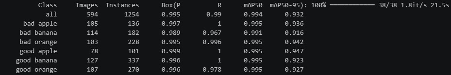
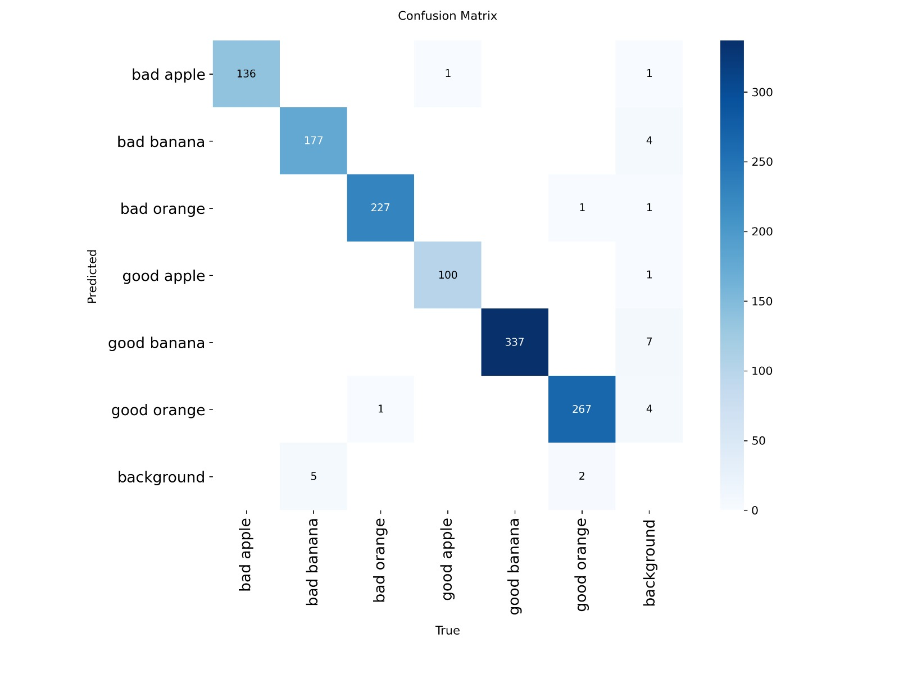
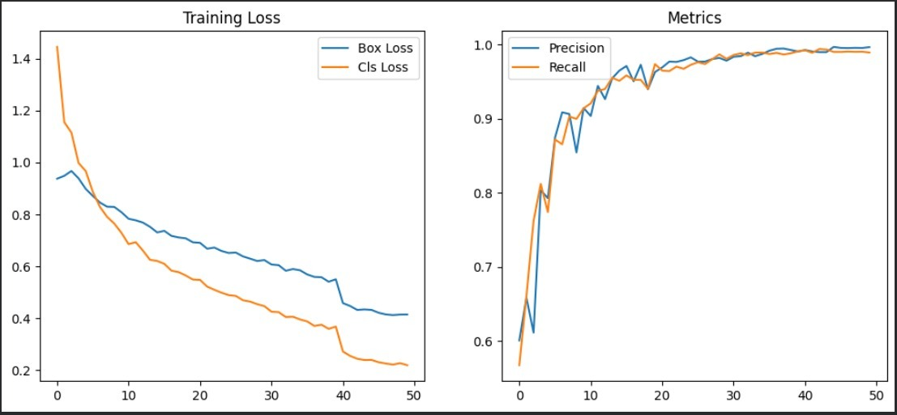

# ML-Integrated Automated Sorting System on Conveyor Belt

An Arduino-based conveyor belt sorting project that combines a machine-learning model with embedded control. The project materials include an Arduino firmware file, the project report, and machine-learning evaluation screenshots.

## Project Overview

The system is designed to capture images of objects, classify them using a machine-learning model running on a host computer, and send a sorting command to an Arduino Uno. The Arduino controls the conveyor and sorting gates and displays status information on an LCD.

## Hardware

- Arduino Uno
- Conveyor belt and motor drive
- Stepper motor and driver (as used in the supplied firmware)
- Servo motors
- LCD display
- Sensors listed in the supplied firmware: LDR, moisture sensor and metal detector
- Buzzer
- Camera 

Refer to the project report and firmware for the documented hardware details and pin assignments.

## Machine-Learning Results

The supplied evaluation screenshots show six fruit-condition labels:

- Bad apple
- Bad banana
- Bad orange
- Good apple
- Good banana
- Good orange

The class-metrics screenshot reports an overall precision of 0.995, recall of 0.990, mAP@50 of 0.994 and mAP@50–95 of 0.932. These values are transcribed from the supplied screenshot.

### Evaluation screenshots

**Class-wise metrics**



**Confusion matrix**



**Training curves**



## Arduino Firmware

The supplied Arduino firmware is available at:

`src/arduino/sorting_system.ino`

The firmware uses serial commands to start sorting cycles:

- `A` – Apple
- `B` – Guava
- `C` – Lemon

It controls a stepper motor, two servo gates, an LCD and a buzzer. The firmware PDF is also included in `docs/arduino_firmware_reference.pdf`.

## Repository Contents

```text
Automated-Conveyor-Belt-Sorting-System/
├── src/
│   └── arduino/
│       └── sorting_system.ino
├── model_results/
│   ├── class_metrics.jpg
│   ├── confusion_matrix.jpg
│   └── training_curves.jpg
├── block_diagram/
│   └── (add system diagram here if available)
├── docs/
│   ├── project_report.pdf
│   └── arduino_firmware_reference.pdf
├── README.md
└── .gitignore
```

## Important Notes

- The Python machine-learning source code and trained model files from the original project are currently unavailable.

## Project Report

See [`docs/project_report.pdf`](docs/project_report.pdf) for the full project documentation.
